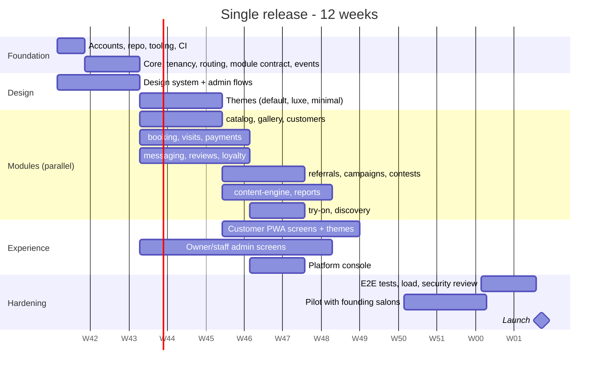

# Salon Growth Platform: Build Plan

The engineering plan for building everything in [`PRODUCT.md`](./PRODUCT.md) as **one release**. It covers:

- the team and timeline
- the repository and tooling
- the foundation code, data model and event catalogue
- what each module must do and how we check it
- themes and the PWA
- outside integrations
- testing, security, environments, CI/CD, monitoring
- the launch checklist

---

## Contents

1. [Scope and principles](#1-scope-and-principles)
2. [Team, timeline and workstreams](#2-team-timeline-and-workstreams)
3. [Accounts and services to set up](#3-accounts-and-services-to-set-up)
4. [Repository and tooling](#4-repository-and-tooling)
5. [Foundation](#5-foundation)
6. [Data model](#6-data-model)
7. [Event catalogue](#7-event-catalogue)
8. [Module build specs](#8-module-build-specs)
9. [Themes and customer UI](#9-themes-and-customer-ui)
10. [PWA, notifications and wallet pass](#10-pwa-notifications-and-wallet-pass)
11. [Integrations](#11-integrations)
12. [Owner/staff admin and platform console](#12-ownerstaff-admin-and-platform-console)
13. [Testing strategy](#13-testing-strategy)
14. [Security, privacy and compliance](#14-security-privacy-and-compliance)
15. [Performance and scalability](#15-performance-and-scalability)
16. [Environments, CI/CD and releases](#16-environments-cicd-and-releases)
17. [Monitoring and operations](#17-monitoring-and-operations)
18. [Launch checklist](#18-launch-checklist)
19. [Definition of done](#19-definition-of-done)
20. [Build risks](#20-build-risks)

---

## 1. Scope and principles

**Scope:** every feature in `PRODUCT.md` section 10, built and launched together. Features that start switched off (AI try-on, city discovery) are still built and tested; they are simply off by default.

**Principles:**

1. **Reuse before build.** Payload provides the admin, auth, API and media handling. Inngest provides jobs. Official providers handle WhatsApp and payments. We write only business logic and UI.
2. **Modular monolith.** One app and one deployment. Features are modules that never import each other and communicate only through events.
3. **Tenant safety first.** Every record belongs to a salon. A tenant-isolation test suite must pass on every pull request.
4. **Settings over code.** Differences between salons live in settings, feature switches and themes, never in `if (salon === ...)` branches.
5. **Phone-first.** Every customer and staff screen is designed for a 360px-wide phone first.
6. **Measured.** Every important action emits an event row; dashboards are queries over those rows.

---

## 2. Team, timeline and workstreams

### Assumed team

| Role | Count | Responsibilities |
| --- | --- | --- |
| Tech lead / full-stack | 1 | Foundation, architecture, code review, integrations, DevOps |
| Full-stack developers | 2 | Modules, admin screens, tests |
| Front-end / UI developer | 1 | Themes, customer PWA, animations |
| Product designer | 1 (part-time) | Design system, themes in Figma, admin flows |
| Founder (product owner) | 1 | Salon conversations, content, WhatsApp templates, acceptance testing |

With fewer people the plan is the same and the calendar stretches. A solo developer working with AI coding tools should allow roughly 2.5× the time.

### Timeline: 12 weeks to launch



| Weeks | What gets done |
| --- | --- |
| 1 | Accounts, repository, tooling, CI, design system starts |
| 2–3 | Foundation: core package, tenancy, routing, module contract, event bus, adapters, default theme skeleton |
| 4–9 | All modules in parallel; admin screens; themes designed and built; customer PWA screens |
| 8–10 | Platform console; integrations finished; WhatsApp templates approved |
| 10–11 | Founding salons use a staging copy with real menus and staff; fixes |
| 11–12 | End-to-end tests, load test, security review, launch checklist |
| End of 12 | Launch |

### Workstreams and owners

| Workstream | Owner | Modules / areas |
| --- | --- | --- |
| A. Foundation and platform | Tech lead | core, tenancy, routing, events, adapters, CI/CD, platform console |
| B. Bookings and money | Dev 1 | booking, visits, payments, customers |
| C. Growth and retention | Dev 2 | messaging, loyalty, referrals, reviews, campaigns, contests, reports |
| D. Experience | UI dev + designer | themes, customer PWA, content-engine UI, try-on UI, discovery |

---

## 3. Accounts and services to set up

Set these up in week 1. Some approvals take days, so start them early.

| Service | Purpose | Plan | Lead time |
| --- | --- | --- | --- |
| Domain + DNS | Platform domain, wildcard subdomains | Any registrar; DNS on Vercel | 1 day |
| GitHub | Code, pull requests, Actions | Team | Same day |
| Vercel | Hosting, previews, wildcard domain, `bom1` region | Pro | Same day |
| Supabase | Postgres + Storage, Mumbai region | Pro (production), Free or Pro (staging) | Same day |
| Inngest | Events, jobs, schedules | Free, then paid as volume grows | Same day |
| Razorpay | Our subscriptions + partner onboarding for salons' own accounts | Business account, KYC, partner programme | **1–3 weeks** |
| WhatsApp provider (AiSensy / Interakt / WATI / Gupshup) | Official WhatsApp Business API, OTP, reminders, campaigns | Choose by week 2 | **Business verification + template approval: 1–2 weeks** |
| SMS provider (e.g. MSG91) | OTP fallback; India DLT registration | Pay-as-you-go | **DLT registration: 1–2 weeks** |
| Google Cloud | Google Wallet API (loyalty passes), Places API for review links | Wallet issuer account | **Issuer approval: days to weeks** |
| AI image API | Try-on image editing | Pay per image | 1 day |
| Sentry | Errors | Team | Same day |
| PostHog | Product analytics, feature flags | Free tier | Same day |
| Figma | Design | Professional | Same day |

---

## 4. Repository and tooling

### Layout

```
salon-platform/
├── apps/
│   └── platform/                 Next.js app with Payload: admin, API, salon sites, PWA
│       ├── app/
│       │   ├── (payload)/        Payload admin + REST/GraphQL routes
│       │   ├── (site)/[salon]/   customer PWA routes, resolved by middleware
│       │   ├── (console)/        platform console (our team)
│       │   └── api/inngest/      Inngest endpoint
│       ├── middleware.ts         host/path → salon resolution
│       └── payload.config.ts     built from the module registry
├── packages/
│   ├── core/                     tenant context, module contract, event types, utils
│   ├── ui/                       design system: shadcn (admin) + themeable primitives (customer)
│   ├── modules/
│   │   ├── catalog/  gallery/  booking/  customers/  visits/  payments/
│   │   ├── messaging/  loyalty/  referrals/  reviews/  campaigns/
│   │   └── contests/  content-engine/  reports/  try-on/  discovery/
│   ├── themes/
│   │   ├── default/  luxe/  minimal/  custom-example/
│   ├── integrations/
│   │   ├── whatsapp/  sms/  razorpay/  storage/  wallet-pass/  image-ai/  analytics/
│   ├── testing/                  factories, tenant fixtures, Playwright helpers
│   └── config/                   tsconfig, biome, vitest presets
├── docs/
│   ├── adr/                      architecture decision records
│   └── runbooks/                 operations procedures
├── turbo.json
├── pnpm-workspace.yaml
├── biome.json
├── .dependency-cruiser.cjs
├── CODEOWNERS
└── CLAUDE.md                     rules for AI coding tools
```

### Tooling

| Concern | Tool | Rule |
| --- | --- | --- |
| Language | TypeScript (strict) | No `any` without a comment explaining why |
| Package manager | pnpm workspaces | One lockfile |
| Build orchestration | Turborepo | Cache builds and tests; run only affected packages |
| Lint + format | Biome | Runs in pre-commit and CI |
| Module boundaries | dependency-cruiser | Modules may import only `core`, `ui` and `integrations` interfaces |
| Validation | Zod | Every API input and every event payload has a schema |
| Unit/integration tests | Vitest | Run against a real Postgres in Docker |
| End-to-end tests | Playwright | Run against preview deployments |
| Commits | Conventional Commits | Generate the changelog |
| Module generator | Turborepo generators (`pnpm gen module <name>`) | Creates folder, contract, tests and registry entry |

---

## 5. Foundation

Built in weeks 1–3 by the tech lead. All other work depends on it.

### 5.1 Core package (`packages/core`)

- `defineModule()`: the module contract (`key`, `collections`, `settings`, `on`, `jobs`, `adminViews`, `blocks`, `api`, `permissions`).
- Module registry, which builds the Payload config, event subscriptions, Inngest functions, admin navigation and site blocks.
- `TenantContext`: the current salon, its plan, enabled features and settings, available on the server for each request.
- `isEnabled(salon, featureKey)`: the one place feature switches are checked.
- Event types: one Zod schema per event, plus a typed `emit()` and typed handlers.
- Utilities: money in integer paise, phone numbers in E.164 (libphonenumber-js), dates stored in UTC and shown in IST (date-fns-tz), ID generation.

### 5.2 Multi-tenancy

- Payload multi-tenant plugin, with `salons` as the tenant collection.
- Every tenant-scoped collection gets a required, indexed `salon` field, applied automatically through the module contract.
- Access rules: staff see only their own salon; platform admins see everything; customers see only their own records within one salon.
- **Tenant-isolation test suite** (in `packages/testing`): for every collection and every API route, a user of Salon A gets nothing from Salon B. CI fails the build if a new collection is missing from the suite.

### 5.3 Routing

- `middleware.ts` resolves the salon from:
  - a subdomain: `glamnails.ourbrand.in`
  - a path: `ourbrand.in/s/glamnails`
  - a custom domain, looked up in `salons.domains`
- The resolved salon is cached in Vercel's edge cache for 60 seconds and invalidated when settings change.
- An unknown salon gets a branded 404 page. A suspended salon (unpaid) shows a "temporarily unavailable" page.

### 5.4 Auth

| Who | How |
| --- | --- |
| Platform admins | Payload auth (email + password + TOTP two-factor) |
| Owners and staff | Payload auth on the `staff` collection, with roles `owner`, `manager` and `artist`; login by phone + OTP or email + password |
| Customers | Separate `customers` auth collection; phone + OTP over WhatsApp with SMS fallback; 90-day session cookie scoped to the salon |

OTP: 6 digits, 5-minute expiry, at most 3 attempts, and at most 5 sends per phone per hour.

### 5.5 Events and jobs

- Every `emit()` writes an `events` row (salon, type, actor, payload, time) **and** sends the event to Inngest.
- Inngest functions are generated from each module's `on` and `jobs` entries.
- Delayed steps (for example "+2 hours", "cycle −5 days") use Inngest `step.sleepUntil`, so each journey is one durable function per visit.
- Each handler must be safe to run twice. Deduplication uses `event.id`.

### 5.6 Adapters (`packages/integrations`)

Each adapter has an interface in `core` and an implementation in `integrations`, plus a fake implementation for tests.

| Interface | Production implementation | Test implementation |
| --- | --- | --- |
| `MessagingProvider` | Chosen WhatsApp provider; click-to-chat fallback | In-memory outbox |
| `OtpProvider` | WhatsApp authentication template, SMS fallback | Fixed code `000000` |
| `PaymentProvider` | Razorpay (salon's own account through partner OAuth) | Fake gateway |
| `StorageProvider` | Supabase Storage (S3-compatible API) | Local folder |
| `WalletPassProvider` | Google Wallet API | No-op |
| `ImageAiProvider` | Chosen AI image API | Returns the input image |
| `Analytics` | PostHog | No-op |

### 5.7 Design system (`packages/ui`)

- Tailwind with **design tokens as CSS variables**: colours, fonts, radii, spacing scale, shadow and motion speed.
- Admin: shadcn components as they are.
- Customer: shadcn/Radix primitives wrapped in themeable components (`Button`, `Card`, `Sheet` built on Vaul, `Carousel` built on Embla, `Reveal` built on Motion).
- Storybook is optional. A `/dev/ui` page that renders every component under every theme is required.

---

## 6. Data model

Collections are listed by the module that owns them. Every collection marked *(tenant)* has a required `salon` field. Every collection has `createdAt`, `updatedAt`, soft delete (`deletedAt`) and version history where noted.

### Platform (core)

| Collection | Key fields |
| --- | --- |
| `salons` | name, slug, domains[], plan, status (trial/active/suspended), features[], settings (json, validated by each module's schema), theme key + theme overrides, timezone, languages[], branding (logo, icon, colours, fonts) |
| `branches` *(tenant)* | name, address, geo, phone, hours, Google Place ID |
| `staff` *(tenant)* | name, phone, email, role, branches[], active, avatar, bio |
| `platformAdmins` | name, email, 2FA |
| `events` *(tenant)* | type, actorType, actorId, subjectType, subjectId, payload (json), source, at |
| `subscriptions` | salon, plan, Razorpay subscription ID, status, next billing date |
| `costLedger` *(tenant)* | kind (whatsapp/sms/ai), units, unit cost, total, period |
| `pages` *(tenant)* | ordered blocks for the home page and custom pages (block builder) |

### Module collections

| Module | Collection | Key fields |
| --- | --- | --- |
| catalog | `services` *(tenant)* | name, category, description, price (paise), duration (min), cycle days, deposit rule, images, active, order |
| catalog | `packages` *(tenant)* | name, services[], price, validity days |
| gallery | `designs` *(tenant, versioned)* | title, images[], category, season tags, service, price from, duration, artist, source (staff/customer), customer consent, featured, published |
| gallery | `moodboards` *(tenant)* | customer, designs[] |
| customers | `customers` *(tenant, auth)* | phone (E.164), name, birthday, language, consents {marketing, gallery, contest}, source, referrer, segment, tags, notes, lifetime spend, visit count, last visit, next due date |
| booking | `availability` *(tenant)* | staff, branch, weekly hours, breaks, time off |
| booking | `appointments` *(tenant)* | customer, staff, branch, services[], design, inspiration images[], start, end, status (requested/confirmed/completed/cancelled/no-show), source, deposit payment, pre-booked (bool), notes |
| booking | `waitlist` *(tenant)* | customer, services[], preferred window, status |
| visits | `visits` *(tenant)* | appointment, customer, staff, services[] with price, discounts, total (paise), payment mode, payment, photos[], design, rating |
| payments | `payments` *(tenant)* | kind (deposit/visit/package/gift card/wallet top-up), amount, status, Razorpay IDs, customer |
| payments | `wallets` *(tenant)* | customer, balance (paise), ledger entries |
| payments | `giftCards` *(tenant)* | code, value, buyer, recipient phone, status, expiry |
| payments | `customerPackages` *(tenant)* | customer, package, remaining services, expiry |
| messaging | `messageTemplates` *(tenant or global)* | key, category (utility/marketing/authentication), language, body, provider template ID, approval status |
| messaging | `messages` *(tenant)* | customer, template, channel, status, cost, related event |
| messaging | `journeys` *(tenant)* | service category, step timings (json), enabled |
| loyalty | `loyaltyRules` *(tenant)* | stamps for reward, points per ₹, tier thresholds, birthday reward, scratch-card prize table |
| loyalty | `loyaltyAccounts` *(tenant)* | customer, stamps, points, tier, Wallet pass ID |
| loyalty | `rewards` *(tenant)* | customer, kind, value, valid from/to, status, source |
| referrals | `referrals` *(tenant)* | referrer, invitee phone, code, status (sent/visited/rewarded), rewards |
| reviews | `ratings` *(tenant)* | visit, score, comment, Google link sent, owner follow-up status |
| campaigns | `offers` *(tenant)* | title, rule, audience (segment), channel, budget, start/end, status |
| campaigns | `campaignPacks` *(global)* | festival, templates, creative assets, default offer |
| campaigns | `trackingLinks` *(tenant)* | code, source, medium, campaign, target URL, clicks |
| contests | `contests`, `entries`, `votes` *(tenant)* | contest dates and prize; entry (visit photo, customer); vote (voter phone, consent) |
| content-engine | `photoTasks` *(tenant)* | visit, status, photos, frame, share kit URLs, share verified |
| content-engine | `frames` *(global or tenant)* | name, theme, season, overlay asset |
| content-engine | `articles` *(global)* | title, body, tags, languages |
| try-on | `tryOns` *(tenant)* | customer, input image, design, output image, credits used |
| discovery | `cityListings` | salon, city, opted in, featured |
| reports | (no tables of its own) | SQL views over `events`, `visits`, `appointments` |

### Database rules

- Payload migrations only; every migration is reviewed.
- Indexes on `(salon, …)` for every list query, `customers(salon, phone)` unique, `appointments(salon, staff, start)`, `events(salon, type, at)`.
- Money is never stored as a floating-point number.
- Personal data fields are tagged in the schema so data export and deletion jobs can find them.

---

## 7. Event catalogue

Events are the only way modules talk to each other. The schema for each lives in `packages/core/events`.

| Event | Emitted by | Consumed by |
| --- | --- | --- |
| `link.clicked` | campaigns | reports |
| `customer.registered` | customers | loyalty (create account), referrals (attach referrer), messaging (welcome) |
| `booking.requested` | booking | messaging (confirm to customer, alert owner), reports |
| `booking.confirmed` | booking | messaging (confirmation + reminders), payments (deposit link) |
| `booking.cancelled` | booking | booking (waitlist offer), messaging, reports |
| `booking.no_show` | booking | customers (flag), reports |
| `visit.completed` | visits | loyalty, reviews, messaging (journey), content-engine (photo task), referrals, customers (stats), reports |
| `payment.captured` | payments | visits (attach), booking (deposit paid), loyalty (wallet), reports |
| `photo.shared` | content-engine | customers, loyalty (points after verification), reports |
| `share.verified` | content-engine | loyalty |
| `rating.submitted` | reviews | messaging (Google link / owner alert), reports |
| `referral.sent` | referrals | messaging, reports |
| `referral.converted` | referrals | loyalty (rewards both people), reports |
| `reward.issued` / `reward.redeemed` | loyalty | messaging, reports |
| `segment.changed` | customers (nightly job) | messaging (due / at-risk / lapsed steps) |
| `offer.launched` | campaigns | messaging (send to audience) |
| `contest.vote_cast` | contests | customers (create lead), reports |
| `tryon.generated` | try-on | payments (credit ledger), reports |
| `message.sent` / `message.failed` | messaging | platform cost ledger, reports |

Every event payload carries `salonId`, `eventId`, `occurredAt` and the actor.

---

## 8. Module build specs

Each module is a folder in `packages/modules/<name>` that follows the contract. Each spec lists what to build and the **acceptance criteria**: the checks that must pass before the module is done.

### 8.1 catalog

- **Build:** services, packages, categories, ordering, cycle days per service, deposit rule per service; admin CRUD; site blocks `ServiceList` and `PackageList`.
- **Accept:**
  - [ ] Owner adds a service from a phone in under 1 minute
  - [ ] Prices display in ₹ correctly, with no rounding errors
  - [ ] An inactive service disappears from the site within 60 seconds

### 8.2 gallery

- **Build:** designs with multiple images, categories and season tags, artist credit, "Book this design" link to booking with the design pre-filled, moodboard, customer-sourced designs (consent required), image transformations for thumbnails.
- **Accept:**
  - [ ] Gallery of 200 images loads its first screen in under 2 seconds on a 4G phone
  - [ ] "Book this design" opens booking with service and design selected
  - [ ] A customer photo appears only when the customer has consented to the gallery

### 8.3 customers

- **Build:** phone + OTP login, profile, consents, language, segments (nightly job), customer view in the admin (history, spend, designs, notes), import from CSV, data export and deletion on request.
- **Accept:**
  - [ ] The same phone at two salons creates two separate customers
  - [ ] The nightly segment job sorts customers into new, regular, due, at risk, lapsed and VIP according to cycle days
  - [ ] Withdrawing marketing consent stops promotional messages immediately

### 8.4 booking

- **Build:**
  - Availability per artist and branch; slot calculation from service duration
  - Booking request and confirmation by staff, with optional auto-confirm per salon
  - Inspiration photo upload
  - Deposit rule enforcement
  - Pre-booking at checkout
  - Waitlist with automatic offer on cancellation
  - Calendar invite (.ics)
  - Staff calendars
  - Reminders through messaging
- **Accept:**
  - [ ] Two customers cannot book the same artist slot; a database constraint plus a test prove it
  - [ ] A booking that requires a deposit stays `requested` until the deposit is paid
  - [ ] A cancellation offers the slot to the first matching waitlist customer within 1 minute

### 8.5 visits

- **Build:** 10-second checkout (customer search by phone, services, adjustments, reward redemption, payment mode), payment link or dynamic UPI QR, pre-booking prompt, scratch-card reveal, `visit.completed` emission.
- **Accept:**
  - [ ] Checkout for a returning customer takes 4 taps or fewer after search
  - [ ] Totals are correct with discounts, rewards and wallet in any combination, covered by property tests
  - [ ] A paid UPI or payment link attaches to the visit automatically

### 8.6 payments

- **Build:** Razorpay partner onboarding for salons; payment links and UPI QR; deposits; wallet top-ups and ledger; prepaid packages; gift cards; webhook handling with signature checks; refunds; platform subscription billing for salons.
- **Accept:**
  - [ ] Money for salon payments settles into the salon's Razorpay account, never ours
  - [ ] Replaying a webhook twice changes nothing
  - [ ] The wallet ledger always equals the wallet balance, checked by a nightly reconciliation job

### 8.7 messaging

- **Build:**
  - WhatsApp templates by category and language (English, Gujarati, Hindi)
  - Journey engine: the post-visit sequence with per-service timings
  - Frequency caps and consent checks
  - Click-to-chat fallback when the API is unavailable
  - Delivery status tracking
  - Cost ledger entry per message
  - Owner daily summary at 9:00 IST
- **Accept:**
  - [ ] No promotional message goes to a customer without marketing consent
  - [ ] A customer never receives more than 1 promotional message a week or 3 a month
  - [ ] Every message sent appears in the cost ledger with its category price
  - [ ] Booking the refill cancels the remaining reminder steps

### 8.8 loyalty

- **Build:** stamps, points, tiers, birthday-month reward, scratch cards with a prize table, next-visit reward (valid within the cycle, cross-sell rules), discount budget enforcement, Google Wallet pass creation and updates.
- **Accept:**
  - [ ] Rewards are issued only after `visit.completed`
  - [ ] When the monthly discount budget is reached, no new discount rewards are issued, but extras (free art, cuticle spa) still are
  - [ ] The Wallet pass updates within 5 minutes of a stamp

### 8.9 referrals

- **Build:** gift-a-friend link and WhatsApp share, referral codes, attribution at signup, two-sided rewards after the friend's first completed visit, leaderboard, fraud checks (same phone, same device, self-referral).
- **Accept:**
  - [ ] The referrer is rewarded only when the friend completes a first visit
  - [ ] Self-referral and repeat phone numbers are rejected

### 8.10 reviews

- **Build:** rating request at +2 hours, Google review link for **everyone** with a private line to the owner for unhappy customers, owner alert on a low rating, recovery tracking.
- **Accept:**
  - [ ] Every customer who rates gets the Google link (no review gating)
  - [ ] No reward is ever attached to a Google review
  - [ ] A rating of 3 or less alerts the owner within 1 minute

### 8.11 campaigns

- **Build:** offers with audiences (segments), slot-filler deals from free slots, festival campaign packs (global library → one-tap launch), first-visit offer (one per phone), tracking links and QR codes, campaign results.
- **Accept:**
  - [ ] A slot-filler deal targets only customers who are due and have consented
  - [ ] Each QR code and link records its clicks and the bookings it produced

### 8.12 contests

- **Build:** Nail of the Month (automatic entries with consent, voting with OTP and consent, results, winner reward), terms page per contest, festival contests.
- **Accept:**
  - [ ] One vote per phone per contest
  - [ ] Every voter who consents is created as a lead customer

### 8.13 content-engine

- **Build:**
  - Photo-corner camera in the staff app: guides, frames, design name, artist credit
  - Share-kit generation: Instagram story, WhatsApp Status and square, each carrying the customer's referral link
  - One-tap share verification
  - "Feature my nails" publishing to the gallery
  - Weekly collage and before/after generation
  - Article library shown per salon brand
- **Accept:**
  - [ ] The share kit reaches the customer within 1 minute of the photo
  - [ ] Generated images are correct at 1080×1920 and 1080×1080 and carry the salon's handle
  - [ ] A customer photo is never published without gallery consent

### 8.14 reports

- **Build:** insights (bookings by source, revenue, average bill, first-to-second-visit rate, repeat rate, revenue by service and artist, no-shows, discount spend, campaign results), daily summary data, monthly ROI report (WhatsApp + PDF), platform-wide health metrics.
- **Accept:**
  - [ ] Every number in the ROI report can be traced to event rows, covered by tests with fixtures
  - [ ] The dashboard loads in under 1.5 seconds for a salon with 2 years of data

### 8.15 try-on

- **Build:** colour and shape preview on a hand illustration and on the customer's own photo (client-side canvas); AI try-on through `ImageAiProvider` with credits, a per-customer cap and a moderation check.
- **Accept:**
  - [ ] The free preview works offline after first load
  - [ ] AI try-on refuses once credits or the cap are exhausted, and every generation is in the cost ledger

### 8.16 discovery

- **Build:** city page listing opted-in salons, search by service, links into each salon's booking; off by default, controlled from the platform console.
- **Accept:**
  - [ ] Only opted-in salons appear
  - [ ] The page does not show customer data from any salon

---

## 9. Themes and customer UI

### Theme contract

```ts
defineTheme({
  key: 'luxe',
  tokens: { colors, fonts, radius, spacing, motion },
  components: { Hero, ServiceList, GalleryGrid, OfferCard, LoyaltyCard, BookingCta, ... }, // only overrides
  layouts: { home, menu, gallery },
})
```

- A theme overrides only what it changes and falls back to `default` for the rest.
- Themes receive data as props and never fetch it.
- Salon-level overrides (colours, fonts, logo) are applied on top of the theme's tokens.

### Themes at launch

| Theme | Look |
| --- | --- |
| default | Clean, light, rounded, sans-serif |
| luxe | Dark or cream background, serif headings, gold accents, slow reveals |
| minimal | White space, editorial grid, image-first |
| custom-example | One fully custom theme to prove the contract for the Growth plan |

### Customer UI quality bar

- Designed in Figma first, mobile at 360px and 390px widths.
- Motion for page transitions and reveals; Vaul bottom sheets for booking and filters; Embla swipe galleries.
- Images served through Supabase transformations as WebP/AVIF in the correct sizes; blur placeholders.
- Lighthouse on a mid-range phone profile: Performance ≥ 90, Accessibility ≥ 95, PWA installable.
- Gujarati and Hindi text renders correctly with the chosen fonts (Noto Sans Gujarati / Devanagari fallbacks).

### Internationalisation

- next-intl with English, Gujarati and Hindi message files.
- WhatsApp templates in all three languages.
- The customer's language preference is stored and used for messages.

---

## 10. PWA, notifications and wallet pass

- **Manifest per salon,** generated dynamically: name, short name, icons (generated from the logo at 192, 512 and maskable sizes), theme colour, start URL scoped to the salon.
- **Service worker** with Serwist: offline shell, cached menu and gallery, background retry for booking requests.
- **Install prompt** shown only after a good moment (points earned, photos received), never on first visit.
- **Web push:** VAPID keys per platform; subscriptions stored per customer and salon. iOS push works only after the customer installs the app, so WhatsApp remains the default channel.
- **Google Wallet loyalty pass:** a class per salon and an object per customer, updated on stamp, points and tier changes.

---

## 11. Integrations

| Integration | Work |
| --- | --- |
| WhatsApp provider | Business verification, phone number per salon (or a shared platform number at first), template creation in 3 languages, webhook for delivery status and replies, opt-out handling |
| SMS | DLT registration, OTP template, fallback logic |
| Razorpay | Partner account; salon onboarding through OAuth so payments go to the salon's account; payment links, UPI QR, webhooks, refunds; our own subscription plans for salons |
| Supabase Storage | Buckets per purpose (gallery, visit photos, share kits, try-on), signed URLs for private images, image transformations |
| Google | Wallet API issuer, Places API (Place ID → review link) |
| AI image API | Prompt templates for nail designs, safety filter, timeout handling |
| PostHog | Events from the customer and admin apps, feature flags per salon |
| Sentry | Front end + server, with the salon ID tagged on every error |

**Verify with Razorpay before building:** the exact partner and onboarding model that lets payments settle into the salon's own account without us holding funds.

---

## 12. Owner/staff admin and platform console

### Owner/staff admin (inside Payload, customised)

- Phone-first custom views built on Payload's admin: **Today**, **Checkout**, **Photo corner**, **Customers**, **Catalogue**, **Campaigns**, **Insights**, **Team**, **Settings**.
- Role-based screens: artists see Today, Checkout, Photo corner and their own portfolio; owners see everything.
- Every module adds its own admin views through the contract, and navigation is generated from the registry.

### Platform console (our team)

- Create salon: slug, domains, plan, features, theme, branding.
- Impersonate a salon's owner, with each session recorded in an audit log.
- Subscriptions and invoices; suspend and reactivate salons.
- Health per salon: activation (20 customers in 14 days), bookings per month, support hours, churn risk.
- Cost ledger: WhatsApp, SMS and AI per salon per month, exported for billing.
- Global content: campaign packs, frames, articles, message templates.
- Feature rollout per salon; discovery page per city.

---

## 13. Testing strategy

| Level | Tool | What it covers | Gate |
| --- | --- | --- | --- |
| Unit | Vitest | Pricing, rewards, segments, slot calculation, journey timing | Every PR |
| Integration | Vitest + Postgres in Docker | Module handlers with real database; events in and out | Every PR |
| Tenant isolation | Vitest | Every collection and route, Salon A vs Salon B | Every PR, cannot be skipped |
| Contract | Vitest | Every event payload matches its schema; every module matches the contract | Every PR |
| End-to-end | Playwright | Book → confirm → checkout → photo → share; referral end to end; deposit payment; OTP login | Every PR on preview |
| Visual | Playwright screenshots | Key screens under every theme | Every PR touching `ui` or `themes` |
| Load | k6 | 200 salons, 50 concurrent bookings, 10k messages queued | Before launch |
| Accessibility | axe in Playwright | Customer screens | Every PR |

Fake adapters (section 5.6) mean no test ever sends a real message or payment.

---

## 14. Security, privacy and compliance

- **Tenant isolation** (section 5.2) is the top security control.
- **Secrets** live in Vercel and Supabase environment variables and are never committed. Each environment has its own keys.
- **Webhooks** (Razorpay, WhatsApp) have their signatures verified and are deduplicated.
- **Rate limits** on OTP, booking, voting and referral endpoints (Upstash Redis or Vercel's built-in limits).
- **Images:** uploads are type- and size-checked; EXIF location data is removed; private images use signed URLs.
- **Admin:** two-factor authentication for platform admins; audit log for impersonation and data exports.
- **DPDP Act:** consent records with timestamp and source; export and deletion jobs; data processing agreement with salons; privacy notice per salon.
- **Policy compliance built in:** no Google review incentives or gating; contest terms; WhatsApp opt-out; message categories respected.
- **Backups:** Supabase daily backups with point-in-time recovery (Pro add-on); one restore drill before launch.
- **Security review** before launch: OWASP checklist, dependency audit, a penetration test of auth and tenant isolation.

---

## 15. Performance and scalability

| Target | Value |
| --- | --- |
| Customer home page, 4G phone | Largest Contentful Paint under 2.0 s |
| Booking API | p95 under 300 ms |
| Admin dashboard | Under 1.5 s with 2 years of data |
| Message journey step accuracy | Within 5 minutes of the scheduled time |

How we meet them:

- Salon pages rendered on the server and cached at the edge, invalidated when content changes.
- Vercel functions in `bom1` (Mumbai) next to Supabase Mumbai; Supabase connection pooling (Supavisor).
- Report queries run on precomputed database views refreshed by Inngest jobs.
- Heavy work (image generation, collages) runs in Inngest jobs, never in a request.
- The scaling path is in `PRODUCT.md` section 9 and needs no rewrite.

---

## 16. Environments, CI/CD and releases

### Environments

| Environment | Hosting | Database | Integrations |
| --- | --- | --- | --- |
| Local | `pnpm dev` | Postgres in Docker, seeded with 2 demo salons | Fake adapters |
| Preview (every PR) | Vercel preview URL | Supabase staging project | Fake adapters, or sandbox where available |
| Staging | `staging.ourbrand.in` | Supabase staging project | Sandbox Razorpay, WhatsApp test number |
| Production | `ourbrand.in` + `*.ourbrand.in` | Supabase production, Mumbai | Live |

### CI pipeline (GitHub Actions)

1. Install, using the Turborepo cache.
2. Biome lint and format check.
3. Type check.
4. dependency-cruiser module-boundary check.
5. Unit, integration, contract and tenant-isolation tests.
6. Migration check (migrations apply cleanly to a fresh database).
7. Vercel preview deployment.
8. Playwright end-to-end, visual and accessibility tests against the preview.

A pull request merges only when every step is green and one reviewer from the module's CODEOWNERS approves.

### Releases

- `main` deploys to staging automatically.
- Production deploys are promoted from staging after a smoke test.
- Database migrations run before the new code goes live, and must stay compatible with the previous code version.
- PostHog flags allow turning a feature off for one salon or all salons without a deploy.
- Rollback is Vercel instant rollback; migrations are written to be backward-compatible so code rollback is safe.

---

## 17. Monitoring and operations

- **Sentry:** alerts on new errors and error spikes, tagged by salon and module.
- **Inngest dashboard:** failed functions, retries and backlogs; alert when failures exceed 1% in an hour.
- **Uptime checks** on the main domain, a sample salon page, the booking API and webhooks.
- **Daily platform report** (to us): bookings, messages sent and failed, payments, errors, cost ledger totals.
- **Runbooks** in `docs/runbooks/`: WhatsApp provider outage (switch to click-to-chat), Razorpay webhook failures, restoring from backup, suspending a salon, data export request.

---

## 18. Launch checklist

**Product**

- [ ] All module acceptance criteria pass
- [ ] Three themes plus one custom example theme complete and reviewed on real phones
- [ ] WhatsApp templates approved in English, Gujarati and Hindi
- [ ] Festival campaign packs ready for the next 3 festivals
- [ ] Articles and aftercare tips written for the main services

**Technical**

- [ ] Load test passed
- [ ] Security review and penetration test findings fixed
- [ ] Backup restore drill done
- [ ] Monitoring and alerts live; runbooks written
- [ ] Production keys set; sandbox keys removed from production

**Business and legal**

- [ ] Terms of service, privacy notice, data processing agreement, contest terms
- [ ] Razorpay partner onboarding working with a real salon account
- [ ] Platform subscription plans live in Razorpay
- [ ] 3 founding salons onboarded on staging and ready to move to production

**Founding salons**

- [ ] Menu, gallery and branding loaded
- [ ] Photo corner set up; QR kit printed
- [ ] Staff trained (30 minutes)
- [ ] Day-14 activation check scheduled

---

## 19. Definition of done

A piece of work is done when:

- [ ] It follows the module contract and passes the boundary check
- [ ] It has unit and integration tests, and tenant-isolation coverage for any new collection
- [ ] Every new event has a schema in `core/events`
- [ ] Every user-facing string is translated (English, Gujarati, Hindi)
- [ ] It works on a 360px-wide phone under every theme
- [ ] It is behind a feature switch if a salon could want it off
- [ ] Errors are reported to Sentry with the salon tagged
- [ ] Documentation is updated (module README, and an ADR if a decision was made)

---

## 20. Build risks

| Risk | Impact | Mitigation |
| --- | --- | --- |
| A single release takes longer than 12 weeks | Late feedback, cost | Founding salons use staging from week 10; flags let us launch with a feature off if it slips |
| WhatsApp, DLT or Google Wallet approvals delayed | Messaging or OTP blocked at launch | Start in week 1; click-to-chat and SMS fallbacks already in the design |
| Razorpay partner model differs from what we assume | Payments flow changes | Confirm with Razorpay in week 1 before building payments |
| Payload multi-tenant plugin limitations | Tenancy rework | Spike in week 2; fallback is a tenant field plus access rules on every collection |
| Tenant data leak | Severe trust and legal damage | Isolation test suite on every PR; penetration test before launch |
| Customer UI looks generic | Weak sales demos | Figma-first themes, design review on real phones, quality bar in section 9 |
| AI try-on quality on hands is poor | Feature disappoints | Off by default; free canvas preview works regardless; compare two APIs before choosing |
| Team bandwidth | Missed dates | Workstreams own modules end to end; the module contract keeps them independent |
