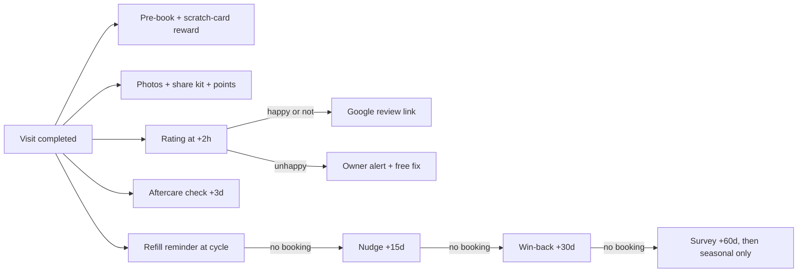
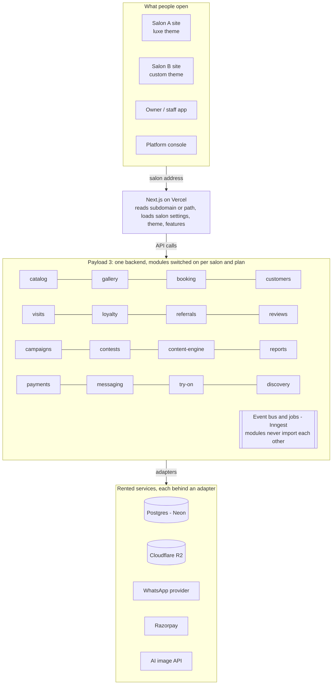

# Salon Growth Platform: Product Description

A branded customer app for every salon, run on one shared platform. It turns Instagram attention into regular customers and gets customers to create the salon's content.

This document describes the complete product end to end. **Everything here is built and launched as a single release**: there is no phased rollout. Some features ship switched off by default and are turned on per salon through settings. That is configuration, not a later build.

---

## Contents

1. [The product in one page](#1-the-product-in-one-page)
2. [Who it serves and why each one cares](#2-who-it-serves-and-why-each-one-cares)
3. [What the customer sees](#3-what-the-customer-sees)
4. [Why customers come back](#4-why-customers-come-back)
5. [How new customers arrive](#5-how-new-customers-arrive)
6. [What the salon gets](#6-what-the-salon-gets)
7. [Business model](#7-business-model)
8. [How we run it](#8-how-we-run-it)
9. [Architecture and scalability](#9-architecture-and-scalability)
10. [Complete feature list by role](#10-complete-feature-list-by-role)
11. [Build and launch plan](#11-build-and-launch-plan)
12. [Risks and open questions](#12-risks-and-open-questions)

---

## 1. The product in one page

We sell a **done-for-you growth system** to nail studios and salons: a branded customer app plus a retention and content engine, set up and run by us for ₹999–1,299 a month.

### What it is

- **For the salon's customers:** the salon's own app, built as a PWA (a web app that installs from the browser, with no app store). Customers open it from Instagram, a QR code or a WhatsApp link. They browse designs, book, keep their nail photos, collect rewards and refer friends.
- **For the salon owner:** a phone-first admin, a daily WhatsApp summary, and a monthly ROI report showing how much revenue the platform brought in.
- **For us:** one shared platform. Every salon gets its own brand and look. The backend, data model and features are the same for all.

### Who it is for first

Independent nail studios in Vadodara with an Instagram following. Their customers book often, spend ₹800–3,000 per visit and return every 3–4 weeks for refills, and that refill cycle is what the product is built around. The same platform then serves:

- lash, brow, makeup and mehendi artists
- beauty parlours
- Ahmedabad, Surat and Rajkot

### Positioning

EaseSeat, Salos and Basil sell operations software (billing, inventory, scheduling) that the owner runs. We sell **outcomes**: more repeat visits, more referrals, more tagged posts, more Google reviews. Full billing, GST invoicing and inventory are deliberately out of scope.

### The pitch to an owner

> *Instagram brings people in, we turn them into regulars, and your customers create your Instagram content for you. One refill booking pays for the month.*

### Decisions already made

| Area | Decision |
| --- | --- |
| Backend + admin | Payload CMS 3 with the multi-tenant plugin; Postgres on Neon |
| Hosting | Vercel |
| Salon address | Subdomain or path on our domain (`glamnails.ourbrand.in`, `ourbrand.in/s/glamnails`); custom domain as an add-on |
| WhatsApp cost | Passed through to the salon at cost |
| Foundation code | Built from open-source parts with permissive licences. AGPL projects such as OpenSalon and Cal.com are used only as references. |
| Delivery | Everything in this document ships in one release |

---

## 2. Who it serves and why each one cares

| User | Their pain today | What they get | Why they keep using it |
| --- | --- | --- | --- |
| **Salon owner** | 50 DMs a day asking the price; empty weekday slots; customers who never return; no idea which channel works; artists who leave take their clients | More repeat visits, filled slots, tagged posts and Google reviews, plus a monthly figure for what we earned them | The ROI report and daily WhatsApp summary prove the value. Customer history, the gallery and prepaid balances make leaving costly. |
| **Staff / artist** | Bookings in a notebook; no recognition; repeating prices all day | 10-second checkout, a photo-corner camera, their own portfolio, pre-booking targets | Credit on every design, a leaderboard, fewer repetitive questions |
| **End customer** | Can't see prices or designs without a DM; forgets when the refill is due; loses paper stamp cards; blurry nail photos | Designs with prices, one-tap booking, professional photos of their nails, rewards, reminders, gifts for friends | Their photo history, wallet balance and points live in the app; reminders arrive just when a refill is due |
| **Us (platform team)** | Every salon wants something custom | One codebase, a theme per salon, features switched on per plan | New salons are onboarded in hours; every new feature reaches all salons at once |

**Design principle:** a customer visits only every 3–6 weeks, so we design for **moments**: choosing, sitting in the chair, after the visit and between visits. We never design for daily use. WhatsApp remains the channel that reaches customers, and the app is where those messages lead.

---

## 3. What the customer sees

The customer sees the salon's own app, with the salon's name and colours. The only mention of us is a small "powered by" link. The app opens from a link and works without installing. We offer the home-screen install only after a good moment, such as earning points or receiving their nail photos.

### Entry points

- Instagram bio link and story link stickers
- QR codes: mirror, bill, shop window, aftercare card
- WhatsApp messages and WhatsApp Status shares
- Google Business Profile
- A friend's referral or share link

Every link records where the customer came from, so the salon knows which channel brought each booking.

### Login

Customers log in with their phone number and a one-time code sent over WhatsApp or SMS. There are no passwords. Customers can browse and send booking requests without logging in.

### Screens

| Screen | What is on it |
| --- | --- |
| **Home** | Hero banner, this month's offers, "New this month" designs, next appointment, points and wallet balance, festival banner |
| **Menu** | Services with price, duration and photos; packages; filters (gel, extensions, nail art, manicure) |
| **Gallery** | Designs by category and season, each with price, time, artist credit and a **Book this design** button; save to a moodboard |
| **Book** | Pick a service or design, an artist, a date and a slot; upload an inspiration photo ("can you do this?"); pay a deposit for long services; confirmation sent to WhatsApp and added to the calendar |
| **My Nails** | Every design they have had, with photos; **Repeat my last design**; refill countdown ("your extensions are 18 days old") |
| **Try-on** | Try colours and shapes on a hand illustration or a photo of their own hand. An AI try-on puts a chosen design onto their hand photo, limited to a few tries per customer or offered as a reward |
| **Rewards** | Stamp card, points, tier (Silver/Gold), scratch cards, next-visit reward with expiry, wallet and prepaid package balance, Google Wallet pass |
| **Invite** | Gift a friend ₹200 off their first visit over WhatsApp; invite status; referral leaderboard |
| **Contests** | Nail of the Month entries and voting |
| **Care tips** | Aftercare for the exact service they had; seasonal trend articles (written once by us, shown in every salon's brand) |
| **Gift cards** | Buy a gift card for someone else |
| **Profile** | Birthday, preferences, marketing consent, language (English, Gujarati, Hindi) |

### Across the visit cycle

1. **Choosing (before):** browse designs with prices, save favourites, upload a Pinterest screenshot for a quote, try designs on their own hand, book.
2. **In the chair (1.5–2 hours for extensions):** pre-book the next refill, scratch the card after paying, enter the contest, invite a friend, add the app to the home screen.
3. **After the visit:** professional photos of their nails arrive with a branded frame and a share kit (Instagram story, WhatsApp Status, square post). Then a rating request and aftercare tips.
4. **Between visits:** refill countdown and reminder, next-visit reward expiry, birthday treat, new designs for the season.

---

## 4. Why customers come back

The retention engine has one job: turn a first visit into a second one. Its main measure is the **first-to-second-visit rate**.

### The automatic journey after every visit

Every completed visit starts this sequence. "Cycle" means the service's repeat interval, set per service: about 3 weeks for gel and extensions, 4 weeks for a manicure.

| When | What happens |
| --- | --- |
| At checkout | Staff offer to **pre-book** the next slot with the same artist; a **next-visit reward** is revealed on a scratch card |
| Day 0 | Professional nail photos, share kit, points credited |
| +2 hours | In-app rating. Everyone gets the Google review link; unhappy customers also get a direct line to the owner |
| +3 days | Aftercare check: "any lifting? free fix within 7 days" |
| Cycle −5 days | "Your refill is due on 28 Oct", with a booking link |
| Cycle day | Reminder, plus the reward's expiry date |
| Cycle +15 days | Soft nudge: new designs this month |
| Cycle +30 days | Win-back: a personal note from their artist plus a stronger offer |
| Cycle +60 days | Last attempt, plus a one-question survey: "why haven't you come back?" |
| After that | No more messages except seasonal campaigns |



### Next-visit rewards that don't teach customers to wait for discounts

- Issued at checkout and valid only within the service cycle (14–30 days), so the deadline matches when they'll need a refill anyway.
- Extras before cash: free art on two fingers, a free cuticle spa.
- Chosen to cross-sell. A gel regular gets "extensions at ₹300 off", which raises the average bill.
- Capped by a discount budget the owner sets, for example 5% of monthly revenue.

### Customer groups, recalculated every night

| Group | Rule | Action |
| --- | --- | --- |
| New | 1 visit | Full post-visit journey; push for the second visit |
| Regular | 2+ visits, returning on cycle | Pre-booking, loyalty, early access |
| Due | Cycle date reached | Reminder |
| At risk | Cycle +15–30 days | Soft nudge |
| Lapsed | Cycle +60 days | Win-back, then seasonal campaigns only |
| VIP | Top 10% by spend | First access to festival slots, birthday gift, a personal touch from the owner |

### Other reasons to return

- **Prepaid packages and wallet** ("pay ₹5,000, get ₹6,000"). Money already paid brings customers back, and the salon gets cash upfront.
- **Stamp card and tiers:** digital so it's never lost, with Silver and Gold tiers that carry real perks.
- **Birthday month:** a treat valid for the whole month.
- **Same artist:** "Riya has slots on Thursday."
- **Recovery:** a low rating triggers an owner call within 24 hours and a free fix.
- **Waitlist:** a cancelled slot goes to the next customer automatically.
- **Google Wallet pass:** the loyalty card lives in Google Wallet and updates itself, so it works even without installing the app.
- **Push notifications** for customers who installed the app; WhatsApp for everyone else.

---

## 5. How new customers arrive

A salon's existing customers become its main source of new ones. Each visit should produce 1–3 tagged posts and a chance to refer a friend.

### Content engine (our main differentiator)

1. **Physical photo corner:** ring light, a fixed backdrop and a hand-rest or prop with the salon's logo. Even a customer's own phone photo shows the brand.
2. **Photo-corner mode for staff:** angle and lighting guides, digital frame templates per theme, the design's name and the artist's credit. Seasonal frames for Navratri, Diwali and bridal.
3. **Share kit sent to the customer:** an Instagram story with the salon's handle, a **WhatsApp Status** version with a short booking link, and a square post. Each link carries the customer's referral code, so every share becomes a trackable referral.
4. **Points for sharing:** staff verify the share with one tap, because Instagram's API can't reliably confirm tags.
5. **"Feature my nails" consent toggle:** the photo joins the gallery as a "Book this design" item.
6. **Auto-generated posts for the owner:** a weekly best-of collage, before/after pairs, artist of the month.

### Referrals

- Framed as a gift: "₹200 off your first visit, from Priya."
- Both people get a reward. The referrer is rewarded **only after the friend completes a visit**.
- Bring-a-friend slots at a combo price; group bookings for bridal parties, sangeet and kitty parties.
- A monthly leaderboard with a prize.

### Competitions

- **Nail of the Month:**
  - Customers who agree are entered automatically.
  - Voting needs a phone number, a one-time code and consent, so voters (mostly friends who aren't customers yet) become leads.
  - Contestants share "vote for me" posts.
  - The winner gets a free set, and the winning design becomes the month's offer.
- Festival design contests, "name this design" stories, recreate-this-look challenges.
- One terms page per contest, including a statement that Instagram does not run it.

### Google

- The review link goes to every customer at +2 hours.
- **We never reward a Google review and never send only happy customers to Google.** Both break Google's policies and can cost the salon its reviews.
- Weekly gallery photos and an up-to-date menu on the Google Business Profile, managed by us as part of the service.

### Local and offline

- Tracked QR codes on the mirror, bill, aftercare card and window.
- Voucher swaps with nearby cafés, boutiques, gyms, bridal shops, makeup and mehendi artists.
- Student offers on weekday afternoons to fill empty slots.
- Pop-up stalls at Navratri venues, college fests and exhibitions.
- **Gift cards** for birthdays, Raksha Bandhan, Valentine's and Diwali. Every recipient is a potential new customer.
- Local micro-influencers (5–20k followers), each with a tracked code and paid per visit they bring.

### Seasonal campaign packs

Ready-to-launch packs for Navratri, wedding season, Karva Chauth, Raksha Bandhan, Diwali, Uttarayan and Valentine's. Each pack contains the offer, a creative template, a WhatsApp message and a gallery section, and the owner launches it with one tap. Navratri pre-booking with deposits and a waitlist is the most valuable pack in Vadodara.

### First-visit offer

One per phone number, used as the hook on every channel. Each channel's link records its source, so the dashboard shows which channels bring customers who actually visit.

### City discovery page

A "book a nail artist in Vadodara" page listing salons on the platform. It is opt-in per salon and **switched off by default** until enough salons in a city have joined. Later it can earn a commission on new customers it brings.

---

## 6. What the salon gets

The owner gets results delivered to WhatsApp, plus a phone-first admin for the few things only they can do.

### Delivered to the owner

- **Daily WhatsApp summary:** *"Yesterday: 9 visits, ₹14,200. 6 customers due for a refill today, 3 at risk. [Send reminders]"*
- **Monthly ROI report:** *"October: 34 bookings came through your page, 12 repeat refills from reminders, 5 new customers from referrals, 41 tagged posts. Revenue influenced: ₹38,400. Your plan: ₹999."*
- **Instant alerts:** new booking request, low rating, cancellation with a waitlist match.

### The owner and staff app

| Area | What it does |
| --- | --- |
| Today | Appointments, requests to confirm, customers due, automatic and one-tap WhatsApp messages |
| Checkout | Customer, services, amount and payment mode in 10 seconds. A payment link or dynamic UPI QR records the sale automatically. Includes the pre-book prompt and scratch-card reward. |
| Photo corner | Camera with guides and frames; sends the share kit to the customer; one-tap share verification |
| Customers | Profile, visit history, designs, spend, group, consent, notes |
| Catalogue | Services, prices, durations, packages, gallery, seasonal sections |
| Campaigns | Offers; slot filler ("Tuesday 2–5pm, 20% off" sent to customers who are due); festival packs; referral and contest settings |
| Insights | Bookings by source, first-to-second-visit rate, repeat rate, average bill, revenue by service and artist, no-show rate, discount spend, campaign results |
| Team | Artists, roles, schedules, staff calendars, pre-booking rate and leaderboard, multiple branches |
| Settings | Branding, opening hours, deposit rules, reward rules, discount budget, message caps, journey timings per service |

### Fast data capture

Every metric depends on records, and salon staff won't type much. So:

- The booking form, not WhatsApp, is the main way enquiries arrive, which gives us structured data.
- Checkout takes 10 seconds.
- A payment through the platform writes the sale record by itself.

Money always goes straight into the salon's own Razorpay account. We never hold funds.

---

## 7. Business model

Subscriptions pay the bills. Transaction fees and brand partnerships are how the business grows beyond one city. All prices below are hypotheses to test in the first 20 sales conversations.

### Plans

The same software is deployed for everyone. A plan only decides which features are switched on and how much service we provide.

| Plan | For | Setup | Monthly | Includes |
| --- | --- | --- | --- | --- |
| Starter | Home-based nail artists | ₹999 | ₹499 | Menu, gallery, booking, stamp card, basic insights |
| Studio | Nail studios (main plan) | ₹2,999 | ₹999–1,299 | Everything in sections 3–6 |
| Growth | Premium salons | ₹4,999+ | ₹2,499+ | Studio plus a custom theme, a monthly photoshoot day, campaigns run for them, priority support |

- **Add-ons:** festival campaign pack (₹999 each), photoshoot visit, custom domain, extra branch, AI try-on credits.
- **WhatsApp messages:** billed at cost.
- **Annual prepay:** pay for 10 months, get 12.
- **Founding customers (first 10):** price locked for life, in exchange for a testimonial, shareable numbers and introductions.

### Unit economics (estimates)

| Item | Value |
| --- | --- |
| Infrastructure per salon | ₹50–150 a month |
| Onboarding time | 6–10 hours, covered by the setup fee |
| Support time | 1–3 hours a month at first; the cost that decides margin |
| Assumed monthly churn | 3–5% |
| Lifetime value | about ₹25,000 plus setup, at 4% churn |
| Salons one person can run | 30–50 |

At ₹999 a month, 50 nail studios bring in about ₹50,000 a month. Reaching ₹1 lakh MRR needs adjacent trades and more cities, not just more nail studios in Vadodara.

### Go-to-market

1. **Founder-led sales for the first 10–20 salons:**
   - List Vadodara nail studios from Google Maps and Instagram.
   - Open with a free Instagram and Google audit.
   - Demo the product on the salon's own menu and photos.
   - Ask for payment in the first meeting.
2. **Channels:**
   - Nail academies, whose graduates open home studios.
   - Gel and product distributors, who visit every salon monthly.
   - Owner referrals, with one free month for each.
   - The "powered by" footer on every salon page.
3. **Expansion:** lash, brow, makeup and mehendi artists and barbers; then Ahmedabad, Surat and Rajkot.

### Additional revenue lines

- A small fee on deposits, prepaid packages and gift cards paid through the platform.
- Brand partnerships: gel and polish brands pay for sponsored designs, sampling and trend data.
- Commission on new customers from the city discovery page.
- A supplies marketplace for salons.

### Metrics the company watches

| Metric | Target |
| --- | --- |
| North star: bookings through the platform per salon per month | Rising month on month |
| MRR | ₹30–40k by month 6, about ₹1 lakh by month 12 |
| Monthly salon churn | Under 3% |
| Activation: 20 customers in the system within 14 days | Every new salon |
| Support hours per salon per month | Under 1.5 |
| Customer first-to-second-visit rate | Higher than the salon's own baseline |

---

## 8. How we run it

Operations run on checklists, templates and a super-admin console, so one person can run 30–50 salons.

### Onboarding a salon (target: live within 48 hours)

1. Sign-up and setup fee; the Razorpay subscription starts.
2. Create the salon in the super-admin console: name, address (subdomain and path), plan, enabled features.
3. Import the menu, prices and durations; upload 20–40 gallery photos.
4. Pick a theme and set colours, fonts and logo. The app's name and icon are generated from these.
5. Connect the salon's Razorpay account and its WhatsApp number through the official provider.
6. Print the QR kit (mirror, bill, window, aftercare card) and set up the photo corner.
7. Train staff for 30 minutes: checkout, pre-booking, photo corner.
8. Activation check at day 14: at least 20 customers in the system. If not, we step in.

### Support

- WhatsApp support line, with response hours stated in the contract.
- Our team can log in as the salon from the super-admin console to see exactly what the owner sees.
- Support hours are logged per salon. More than 1.5 hours a month triggers a review.

### Customisation rules

- Every custom request either becomes a reusable template for all salons or is charged as an add-on.
- Custom themes (Growth plan) change only how pages look, never business logic.
- No salon-specific code anywhere in the modules. Differences live in settings and feature switches.

### Guardrails built into the product

| Guardrail | Reason |
| --- | --- |
| Marketing consent at signup; one-tap unsubscribe | India's DPDP Act and WhatsApp policy |
| At most 1 promotional message a week and 3 a month per customer; reminders exempt | Protects the salon's WhatsApp number from blocks and spam reports |
| Reminders and promotions sent as separate message categories | Meta charges booking-related utility messages less than marketing messages, and the cost is passed to the salon |
| Discount budget per salon | Protects margin |
| Rewards only after a completed visit | Stops fake referrals |
| No incentives for Google reviews, no review gating | Google policy |
| Payments go straight to the salon's account | Avoids RBI rules on holding customer money |
| Customers belong to one salon and are never shared across salons | Trust and the DPDP Act |
| The salon owns its data, we are the processor, data export on request | Contract terms and reassurance against lock-in |
| Official WhatsApp providers only (AiSensy, Interakt, WATI, Gupshup) | Unofficial APIs get numbers banned |

**Company admin:** start as a sole proprietorship or LLP. Register for GST at the threshold. Use standard terms of service and a data processing agreement with salons. Complete Razorpay KYC.

---

## 9. Architecture and scalability

One codebase and one deployment serve every salon. Each feature is an independent module that talks to other modules only through events, so features can be added, removed or changed without breaking each other.



### Stack: reuse instead of building

| Need | Tool |
| --- | --- |
| Admin, API, login, roles, media, per-salon data separation | Payload 3 + multi-tenant plugin |
| Database | Postgres on Neon, with a separate database copy for each pull request |
| Customer site and PWA | Next.js, Serwist (offline support and push notifications), shadcn/ui + Tailwind |
| Background jobs, schedules, events | Inngest |
| Images | Cloudflare R2 |
| Errors, analytics, feature switches | Sentry, PostHog |
| Hosting | Vercel, with a preview link for each pull request |
| Monorepo tooling | pnpm workspaces, Turborepo, Biome |

Running cost at launch is about ₹2–4k a month for all salons together, plus AI try-on usage, which is billed to salons as credits.

### Repository layout

```
apps/
  platform/              Next.js + Payload: admin (/admin), API, all salon sites, PWA
packages/
  core/                  tenant context, money/phone/date utils, event names and types, module contract
  ui/                    shadcn components + theme tokens
  modules/               one folder per feature
    catalog/ gallery/ booking/ customers/ visits/ loyalty/ referrals/ reviews/
    campaigns/ contests/ content-engine/ reports/ payments/ messaging/ try-on/ discovery/
  themes/
    default/ luxe/ minimal/ custom-<salon>/
  integrations/          adapters: messaging, payments, storage, analytics, AI images
  config/                shared tsconfig, lint and test settings
docs/
  adr/                   one page per architecture decision
```

### The module contract

Every module exports the same shape:

```ts
defineModule({
  key: 'loyalty',
  collections: [...],                     // its own tables
  settings: schema,                       // per-salon settings
  on: { 'visit.completed': awardStamp },  // events it reacts to
  jobs: [...],                            // scheduled tasks
  adminViews: [...],                      // its admin screens and widgets
  blocks: [...],                          // sections it adds to the customer site
  api: {...},                             // public functions others may call
})
```

### Module rules (enforced by CI, not by memory)

1. Every feature is a folder under `packages/modules/` that exports the contract above.
2. One registry lists the active modules. The admin panel, event wiring and site sections are all generated from it, so adding or removing a module is a one-line change.
3. Modules never import each other. dependency-cruiser fails the build if one does. Modules react to events such as `booking.requested` or `visit.completed` instead.
4. Each module owns its own tables. Other modules refer to its records by ID only.
5. Features are switched on per salon according to its plan. PostHog flags let us try a change on one salon before all of them.

Example of one event fanning out to several modules:

```
visit.completed ─┬─► loyalty: add stamp / points
                 ├─► reviews: rating request at +2h
                 ├─► booking: refill reminder at cycle
                 ├─► content-engine: photo-corner task
                 ├─► referrals: release referrer reward if first visit of a referred friend
                 └─► reports: update stats
```

### Themes

A salon page is an ordered list of blocks stored in the database: hero, services, gallery, offers, loyalty, booking, and so on. A theme is a set of design tokens plus components for those blocks.

- A theme overrides only what it changes and falls back to the default theme for everything else.
- Themes receive data and never fetch it, so no business logic gets copied into a theme.
- The PWA name, icon and colours are generated per salon.
- Salons with their own website can embed the booking widget and use the public API instead.

### Adapters for outside services

```
MessagingProvider  ->  official WhatsApp provider (AiSensy / Interakt / WATI / Gupshup), click-to-chat fallback
PaymentProvider    ->  Razorpay (money goes to the salon's own account)
StorageProvider    ->  Cloudflare R2
ImageAIProvider    ->  AI image-editing API for try-on
```

Modules call the adapter and never the vendor directly. Switching vendor means writing one new adapter file. Every message is logged with its cost against the salon, ready for pass-through billing.

### Data rules fixed from day one

- Every record carries a tenant (salon) field. A test that proves Salon A can never see Salon B's data must always pass.
- Customers are per salon, even when the same phone number visits two salons.
- Money is stored as integer paise, phone numbers in international format (E.164), and times in UTC, shown in IST.
- Records are soft-deleted and keep a version history.
- Every important action is stored once as an event row. Dashboards and the ROI report are queries over those rows.

### How several people work on it

- Each module has one owner, recorded in CODEOWNERS. A generator creates new modules from a template.
- Types are generated from the schema, and inputs are validated with Zod.
- Every pull request runs type checks, lint, unit tests (Vitest) and end-to-end tests (Playwright) for booking, checkout and referral. Each gets its own preview link and database copy.
- Schema changes go through reviewed migrations. Big decisions are recorded in `docs/adr/`. A CLAUDE.md file describes the rules for AI coding tools.

### Scaling path

| When | Change |
| --- | --- |
| About 100 salons, or slow pages | Caching, and precomputed database views for reports |
| Heavy image or AI load (try-on) | Move only that work to a separate service on its own queue |
| 6+ developers | Split a module into its own service. It already talks only through events and its public API. |
| Hundreds of salons | An analytics warehouse for city-level trends |

Nothing needs a rewrite to scale. A module is split out only when measurements show a reason.

---

## 10. Complete feature list by role

Every feature belongs to one module, and all of them ship in the same release. "Default" shows whether a feature is on when a salon is created; the plan and the owner's settings can change it.

### Customer (salon's PWA)

| Feature | Module | Default |
| --- | --- | --- |
| Branded home, menu with prices, opening hours, location | catalog | On |
| Gallery with categories and "Book this design" | gallery | On |
| Moodboard (saved designs) | gallery | On |
| Booking with real slots, artist choice and inspiration photo | booking | On |
| Deposits for long services | booking, payments | Owner setting |
| Pre-booking and waitlist | booking | On |
| Offers section, first-visit offer | campaigns | On |
| Phone + one-time code login, profile, consent, language | customers | On |
| My Nails: photo history, repeat last design, refill countdown | visits | On |
| Share kit: Instagram story, WhatsApp Status, square post | content-engine | On |
| Rating after the visit, Google review link | reviews | On |
| Stamp card, scratch card, next-visit reward | loyalty | On |
| Tiers (Silver/Gold), birthday month | loyalty | On |
| Google Wallet loyalty pass | loyalty | On |
| Gift a friend, referral status, leaderboard | referrals | On |
| Wallet, prepaid packages, gift cards | payments | On |
| Nail of the Month entry and voting | contests | On |
| Care tips and seasonal articles | content-engine | On |
| Install to home screen, push notifications | platform | On |
| Try-on on a hand illustration or own photo | try-on | On |
| AI try-on (credits, capped) | try-on | Off (add-on) |
| City discovery page | discovery | Off (opt-in) |

### Staff / artist

| Feature | Module |
| --- | --- |
| Today's appointments and requests | booking |
| 10-second checkout (services, amount, payment mode) | visits |
| Payment link or dynamic UPI QR at checkout | payments |
| Customer lookup by phone, visit history, notes | customers |
| Pre-booking prompt at checkout | booking |
| Photo-corner camera with guides and frames | content-engine |
| One-tap share verification | content-engine |
| One-tap WhatsApp messages for customers who are due | messaging |
| Own portfolio and design credit | gallery |
| Personal calendar and schedule | booking |
| Pre-booking rate and leaderboard | reports |

### Salon owner

| Feature | Module |
| --- | --- |
| Edit menu, prices, gallery, offers, hours, branding, page sections | catalog, gallery, campaigns |
| Daily WhatsApp summary | reports |
| Monthly ROI report | reports |
| Insights: bookings by source, revenue, average bill, repeat and first-to-second-visit rate, revenue by service and artist, no-shows, discount spend | reports |
| Customer groups (new, regular, due, at risk, lapsed, VIP) | customers |
| Post-visit journey timings per service | messaging |
| Automated reminders and campaigns via the official WhatsApp provider | messaging |
| Low-rating alert and recovery flow | reviews |
| Slot filler deals | campaigns |
| Festival campaign packs | campaigns |
| Referral and contest settings | referrals, contests |
| Discount budget, message caps, deposit and reward rules | settings |
| Team: artists, roles, schedules, staff calendars | booking |
| Multiple branches | core |
| Auto-generated weekly collage and reel material | content-engine |
| Prepaid packages and gift card setup | payments |
| Data export | core |

### Platform admin (us)

| Feature |
| --- |
| Create a salon: address, plan, feature switches, theme |
| Log in as a salon (impersonation) for support |
| Salon subscriptions and invoices through Razorpay |
| Health view per salon: activation, bookings, support hours, churn risk |
| WhatsApp and AI-credit cost ledger per salon, billed at cost |
| Shared content library (articles, festival packs, frames) published to all salons |
| Feature rollout control per salon |
| Data export per salon |
| City-level trends (most-booked designs in each city) |
| Discovery page management per city |

### Developer

| Capability |
| --- |
| Monorepo with one folder per feature module and a module generator |
| Module registry: add or remove a module in one line |
| Theme contract with fallback to the default theme |
| Event bus and background jobs (Inngest) |
| Adapters for messaging, payments, storage and AI images |
| Generated types, input validation, linting, unit and end-to-end tests in CI |
| Preview deployment and a database copy for every pull request |
| Tenant-isolation test that must always pass |
| Error tracking and product analytics (Sentry, PostHog) |
| Public API and embeddable booking widget |
| Architecture decision records and a CLAUDE.md with module rules |

---

## 11. Build and launch plan

The whole product is built as **one release** and launched complete. Modules are built in parallel on the shared foundation. The order below is the internal order of work within that single release, not separate launches.

### Build order within the release

1. **Foundation:** monorepo, Payload, multi-tenancy, salon routing, default theme, module contract, event bus, adapters, CI, preview deployments, tenant-isolation test.
2. **All modules in parallel**, one owner each: catalog, gallery, booking, customers, visits, payments, messaging, loyalty, referrals, reviews, campaigns, contests, content-engine, reports, try-on, discovery.
3. **Themes:** default, luxe, minimal, plus one custom theme as proof.
4. **Platform console:** salon creation, impersonation, billing, cost ledger, health view.
5. **End-to-end hardening:** booking, checkout, referral and payment tests; load test; security review; WhatsApp template approvals.
6. **Launch** with the founding salons.

### Before launch

- [ ] Talk to 20 Vadodara nail studio owners using the validation questions below
- [ ] Pick the platform brand name and domain
- [ ] Choose the WhatsApp provider and get message templates approved
- [ ] Set up Razorpay partner onboarding so salons connect their own accounts
- [ ] Prepare terms of service, the data processing agreement and contest terms
- [ ] Line up 3 founding customers at ₹2,999 setup + ₹999 a month

### Business milestones after launch

| When | Target |
| --- | --- |
| Launch + 30 days | 3 paying founding salons |
| Launch + 90 days | 10 paying salons, none cancelled, first case study with real numbers |
| Month 6 | 30 salons, support under 1.5 hours per salon, one channel partner signed |
| Month 12 | About ₹1 lakh MRR, churn under 3%, one adjacent trade, second city tested, first hire |

### Validation questions for salon owners

1. How many DMs a day just ask for prices or designs?
2. Do you photograph every finished set? Where do those photos go?
3. How many customers pre-book their next refill before leaving?
4. What happened during last year's Navratri rush?
5. Would you sell a ₹5,000 prepaid package if customers could see their balance on their phone?
6. Would ₹999 a month be worth it if we set this up and ran it for you?

---

## 12. Risks and open questions

The biggest risk is commercial, not technical: whether owners will pay when cheaper operations software already exists. Building everything in one release raises the cost of being wrong, so the conversations with salon owners should run alongside the build and not after it.

| Risk | Mitigation |
| --- | --- |
| Owners don't pay | Ask for payment in the first meeting; change the offer or segment if fewer than 2 of 20 pitches pay |
| Single release takes too long before any feedback | Show the foundation and first modules to founding salons during the build; switch off any feature they don't value |
| Staff don't record visits, so the data dies | 10-second checkout, payments that record the sale, summaries pushed to the owner |
| Death by customisation | Templates or paid add-ons; no salon-specific code |
| Competitor price cuts | Compete on outcomes and service, shown in the ROI report |
| Customers don't install the PWA | Installing is never required; WhatsApp and the Google Wallet pass carry the relationship |
| WhatsApp number bans or cost surprises | Official providers, message caps, cost ledger passed through |
| AI try-on costs | Credits per salon, capped per customer, billed as an add-on |
| Google or Instagram policy breaches | No rewards for reviews, no review gating, a terms page per contest |
| Market too small in one city | Adjacent trades and other Gujarat cities |
| Founder burnout | Support hour cap, checklists, first hire at about 25 salons |
| Multi-tenant plugin turns out immature | Fallback: a tenant field and access rules on every collection, which is what the plugin does internally |

### Open questions

- [ ] Lifestyle business (₹1–2 lakh a month, bootstrapped) or venture (multi-city, marketplace, investors)?
- [ ] How many hours a week can the founder give, and who does the door-to-door sales?
- [ ] Platform brand name and domain.
- [ ] Which WhatsApp provider (AiSensy, Interakt, WATI or Gupshup), compared on price and template approval speed.
- [ ] Which AI image API for try-on, compared on cost per image and quality on hands.
- [ ] Validate salon counts in Vadodara from Google Maps and Instagram.
- [ ] Check the current Google review policy and Meta messaging prices before launch.
